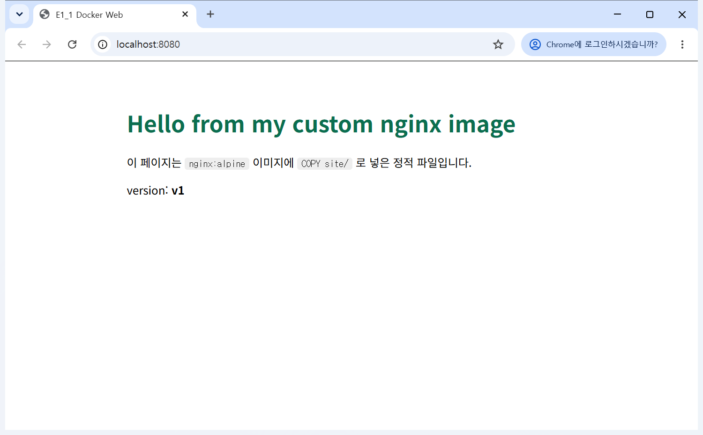
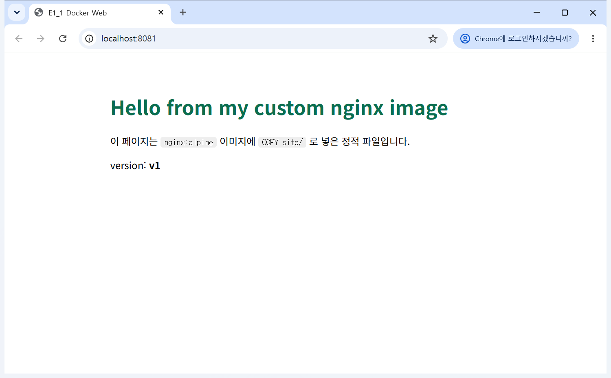

# 07. 포트 매핑 접속 증거 (8080 · 8081, 두 번)

원문 4장 8번 · 2장 6번. 같은 이미지 `e1-1-web:1.0`을 **호스트 포트 8080과 8081로 두 번** 띄워 각각 접속했다.

- 형식: `-p <호스트 포트>:<컨테이너 포트>`. nginx는 컨테이너 안에서 **80번**으로 듣는다.
- 실행 위치: Git Bash, 기록일 2026-11-02

## 왜 포트 매핑이 필요한가

컨테이너는 자기만의 네트워크 공간을 가져서, 안에서 80번 포트가 열려 있어도 **내 PC에서는 닿지 않는다**. `-p 8080:80`은 "내 PC 8080번으로 온 요청을 컨테이너 80번으로 넘겨라"는 연결 통로를 여는 것이다. 컨테이너 안은 둘 다 80번이어도 호스트 쪽 번호만 다르게 하면 같은 이미지를 동시에 여러 개 띄울 수 있다(8080·8081).

## 명령 + 출력

```text
$ docker run -d -p 8080:80 --name web-8080 e1-1-web:1.0
b19dea04fd2cc0d232efd1e376e8228f2c2f4cc100227a66946c224ca7473908

$ docker run -d -p 8081:80 --name web-8081 e1-1-web:1.0
8a2e1e1420e97805c37e13947d8e9d42b234854527c0aca9f7d6dca0230fdf29

$ docker ps
NAMES      IMAGE          PORTS                                     STATUS
web-8081   e1-1-web:1.0   0.0.0.0:8081->80/tcp, [::]:8081->80/tcp   Up 12 seconds (healthy)
web-8080   e1-1-web:1.0   0.0.0.0:8080->80/tcp, [::]:8080->80/tcp   Up 12 seconds (healthy)

$ curl -s http://localhost:8080
<!doctype html>
<html lang="ko">
<head>
  <meta charset="utf-8">
  <title>E1_1 Docker Web</title>
  <style>
    body { font-family: sans-serif; max-width: 640px; margin: 4rem auto; padding: 0 1rem; }
    h1 { color: #0b6e4f; }
    code { background: #eee; padding: 2px 6px; border-radius: 4px; }
  </style>
</head>
<body>
  <h1>Hello from my custom nginx image</h1>
  <p>이 페이지는 <code>nginx:alpine</code> 이미지에 <code>COPY site/</code> 로 넣은 정적 파일입니다.</p>
  <p>version: <strong>v1</strong></p>
</body>
</html>

$ curl -s http://localhost:8081
<!doctype html>
<html lang="ko">
<head>
  <meta charset="utf-8">
  <title>E1_1 Docker Web</title>
  <style>
    body { font-family: sans-serif; max-width: 640px; margin: 4rem auto; padding: 0 1rem; }
    h1 { color: #0b6e4f; }
    code { background: #eee; padding: 2px 6px; border-radius: 4px; }
  </style>
</head>
<body>
  <h1>Hello from my custom nginx image</h1>
  <p>이 페이지는 <code>nginx:alpine</code> 이미지에 <code>COPY site/</code> 로 넣은 정적 파일입니다.</p>
  <p>version: <strong>v1</strong></p>
</body>
</html>

$ curl -sI http://localhost:8080 | head -4
HTTP/1.1 200 OK
Server: nginx/1.31.8
Date: Mon, 02 Nov 2026 10:55:51 GMT
Content-Type: text/html

```

## 브라우저 접속 화면 (주소창 포함)

실제 Chrome 창을 띄워 찍었다(화면 캡처가 아니라 창 자체를 그대로 저장). 주소창에 `localhost:포트`가 보인다.

| 8080 | 8081 |
|---|---|
|  |  |

결과: 두 포트 모두 HTTP 200, 같은 페이지, `docker ps`에 두 컨테이너가 서로 다른 호스트 포트로 `(healthy)`.
